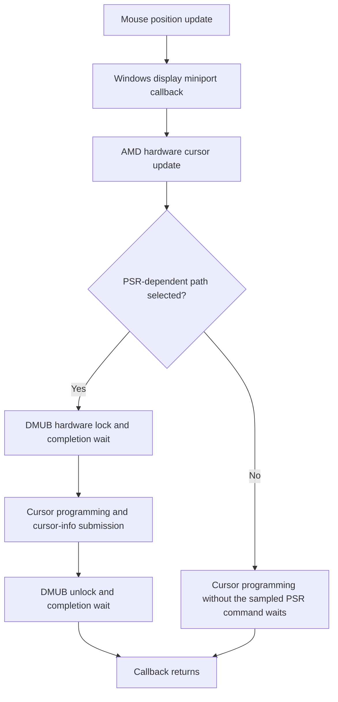

# Hardware cursor stutter in an AMD panel-self-refresh path

## Scope and finding

This report explains a reproducible class of desktop cursor stutter on a hybrid-graphics laptop when an AMD discrete GPU drives the internal eDP panel. A high-polling-rate USB mouse exposed the symptom. Lower polling rates, integrated-GPU display ownership and a software-composed cursor reduced or removed it.

The investigation isolated a PSR-dependent hardware-cursor path in the installed AMD display driver. Setting the selected GPU's `DalPSRFeatureEnable` DWORD to zero and restarting its display device cleared the stutter in a physical 1000 Hz test with the original cursor. Reversing and reapplying the registry change reproduced the corresponding callback-duration change on the same installed driver.

The result supports a configuration workaround for systems with this mechanism. Applicability beyond the reference hardware requires testing. The exact contribution of firmware execution, extra lock transactions and changed host polling has not been independently isolated.

## Symptom pattern

The reference observations were consistent across the following conditions.

| Condition | Observed result |
|---|---|
| 1000 Hz external mouse, discrete GPU driving internal display, newer driver | Desktop cursor stutters |
| Same mouse at 125 Hz | Smooth |
| Internal touchpad | Smooth |
| Integrated GPU driving the internal panel | Smooth at 1000 Hz |
| Discrete-only GPU mode | Stutter remains |
| Older generic AMD driver and tested ASUS OEM driver | Smooth |
| Larger transparent cursor canvas | Smooth, with a changed Windows cursor presentation path |
| Current driver with PSR disabled | Smooth with original cursor scheme |

Fullscreen game smoothness was reported, but games can render their own cursor and change display power behavior. It is an imperfect control for the desktop path. Raising the panel refresh rate above its stock mode reduced perceived stutter in the original report. That observation motivated timing analysis, but does not establish a refresh-rate fix or explain the underlying mechanism.

These symptoms also require ordinary input checks. Confirm the mouse's actual polling-rate setting and connection, and verify the GPU that owns the display. A game rendering on a discrete GPU does not establish that it drives the panel. In a MUX or SmartAccess Graphics system, display ownership can change independently of the application's renderer.

## How the path works

A hardware cursor is positioned through the display driver's pointer-position interface. This can update a cursor plane separately from the rendered desktop. The Windows miniport callback receives the pointer position and must program the display state accordingly. [Microsoft pointer-position interface](https://learn.microsoft.com/en-us/windows-hardware/drivers/ddi/d3dkmddi/nc-d3dkmddi-dxgkddi_setpointerposition)

Panel self-refresh allows an internal display to retain a frame while parts of the display pipeline reduce activity. It is a power-saving mechanism. Updating a cursor while entering, leaving or operating alongside that mechanism requires coordination among the host driver, display hardware and display microcontroller. AMD's public code uses DMUB locking to coordinate register access with PSR. [AMD locking change](https://github.com/torvalds/linux/commit/acbf16a6ae775b4db86f537448cc466288aa307e)



The diagram summarizes the inspected path. It does not imply that all AMD architectures or driver versions use identical command ordering.

In the slow current-driver captures, synchronous waits during cursor updates repeatedly read display-related registers and execute `KeStallExecutionProcessor(1)`. One sampled instruction was the return immediately after a register read. CPU sampling can attribute stalls to the following instruction, so the sampled address is evidence of time around the read rather than an instruction-level latency measurement.

At 1000 Hz, nominal mouse reports arrive one millisecond apart. A callback approaching half a millisecond consumes a substantial part of that interval. At 125 Hz the nominal interval is eight milliseconds. These figures explain why frequent updates can expose an expensive path. Multiplying a median by nominal input rate does not measure CPU utilization, and callback completion does not establish when the panel visibly latched the new coordinate.

## What changed across drivers

The reference system ran smoothly on generic AMD 25.9.2 and stuttered on 25.10.2. This comparison bounds the regression to the releases between those versions.

| Package | RX Windows driver | Embedded Navi 33 DMCUB image | Evidence |
|---|---|---|---|
| AMD 25.9.2 | 32.0.21025.15011 | 7.0.45.0 | Smooth in the reference test |
| AMD 25.10.1 Battlefield 6 Preview | 32.0.21025.25005 | 7.0.45.0 | Static comparison only |
| AMD 25.10.2 | 32.0.22021.1009 | 7.0.46.1 | First failing version tested |
| ASUS OEM | 32.0.21040.6 | 7.0.45.0 | Smooth in the reference test and paired trace captured |
| AMD 26.11.1 | 32.0.32015.16001 | 7.0.49.1 | Slow path captured, workaround verified |

The known-good generic and ASUS kernel binaries gate DMUB cursor hardware locking with existing link-state tests. The first failing 25.10.2 binary adds a helper whose additional branch checks a PSR enum value and the presence of a single eDP link. This matches the structure and constants of AMD's public change enabling hardware-lock-manager use for PSR1 with one eDP panel. Function-name mapping in the proprietary Windows binary is inferred from that structural match. [AMD-authored source change](https://github.com/torvalds/linux/commit/acbf16a6ae775b4db86f537448cc466288aa307e)

The host wait loop also changed. The older loop calls one hardware-status reader and compares its result with cached state. The first failing and current loops call two status readers and perform additional completion-state checks. The public AMD implementation contains related command-completion and concurrent-submission logic. Similarity helps interpret the binary, but does not prove that a particular Linux commit is the Windows regression's sole cause. [AMD command-wait change](https://github.com/torvalds/linux/commit/dd141b16b3a2979a01194615dfe87dbba9d87045)

Current-driver stack paths contain a hardware-lock command builder with type `0x45` and a cursor-information builder with type `0x44`. Lock, cursor-information and unlock call sites reach the synchronous wait loop. The host-side changes and reversible PSR experiment show that the response depends on the driver's selected display path.

Recent AMD packages in the investigation contained separate base-driver branches for different architectures. The RX and integrated GPU used different Windows versions after the current package was restored. Package size and architecture splitting can explain why downloads look different, but neither identifies the cursor regression. Match the actual installed adapter, INF and loaded kernel image for every measurement.

## How the diagnosis was tested

The reference platform was an ASUS TUF A16 FA617NT with an RX 7700S, Ryzen 7 7735HS integrated Radeon graphics and an internal CSW1639 panel. The paired measurements used direct RX display ownership at the factory 165 Hz mode. The Windows build was 26300.9818. This configuration identifies the evidence boundary while the procedure below applies to other systems.

An automated private-window test used a freshly loaded 32-pixel Windows arrow. It moved that pointer for 2.25 seconds, switched to a 512-pixel transparent-padded equivalent for 2.25 seconds, then returned to the ordinary arrow. It checked cursor identity and window ownership during the run and restored the pointer position afterward. Synthetic movement was approximately 200 Hz, constrained by the loop's sleep and callback time. A separate physical mouse test used 1000 Hz.

Graphics traces captured DxgKrnl pointer-position events and paired profiler scopes. In this Windows build, profiler function 5019 was associated with pointer updates using matching threads, event timing and driver stacks. That numeric identifier should be revalidated on other Windows builds. CPU traces supplied sampled stacks, and module load records distinguished the RX image from the integrated image. Cached stack references were resolved when present. Earlier recordings without sampled stacks or without pointer events were excluded from the relevant conclusions.

The experiment temporarily installed the signed ASUS package, verified RX ownership and driver version, captured the same pointer motion, then restored the original AMD drivers. Windows also selected the ASUS integrated driver during the downgrade, so both original GPU branches were restored. The PSR reversal tests subsequently used the same installed AMD version.

| Configuration | Mover-thread pointer calls | Median | p95 |
|---|---:|---:|---:|
| AMD 26.11.1 initial | 855 | 0.4954 ms | 0.6182 ms |
| ASUS OEM | 922 | 0.0939 ms | 0.1847 ms |
| AMD 26.11.1 restored | 871 | 0.4810 ms | 0.5564 ms |
| Current AMD, PSR disabled | 935 | 0.0504 ms | 0.0922 ms |
| Current AMD, original PSR policy restored | 878 | 0.49575 ms | 0.5929 ms |
| Current AMD, PSR disabled again | 979 | 0.0375 ms | 0.0960 ms |

These are callback wall durations on the automated mover's thread, with startup shape changes included. They are not end-to-end mouse latency or a direct 1000 Hz throughput benchmark. The parsed graphics traces reported zero lost events and buffers. All runs used the same nominal scripted workload, with actual move counts affected by execution time.

In the initial AMD mover-thread sample set, 193 of 364 samples inside pointer calls contained the hardware-lock command function. ASUS had zero among 78, and restored AMD had 191 among 365. These counts describe where execution time accumulated during sampling. The PSR-disabled capture had no sampled command-wait stacks of the previously observed forms.

With the registry change active, the original cursor moved smoothly over the desktop, text and links. Restoring the default policy brought back the slow callback timing. Reapplying the change reduced it again. The experiment isolates the PSR-dependent path as the trigger. The relative cost of each lock, register read and microcontroller operation remains unresolved. [Measurement data](measurements.json)

## The registry control

Static analysis identified the current driver's `DalPSRFeatureEnable` descriptor as entry `0x19` in its policy table. A consumer checks for zero and sets a PSR-disable field, adjacent to a diagnostic identifying a registry override of `disable_psr`. This made the test evidence-based.

The value belongs under the selected display adapter's class key. Resolve it through the device's `DEVPKEY_Device_Driver` property, then append that returned key to `HKLM\SYSTEM\CurrentControlSet\Control\Class`. Adapter numbers such as `0000` and `0001` vary between computers and can change after installation. Writing every display adapter would confound the test and affect unrelated display paths.

`REG_DWORD 0` is the tested override. Original absence means the driver chooses its default. Explicit `1` should not be substituted for original absence during restoration because future defaults and OEM policy can differ.

The tool saves the original registry state in an administrator-writable HKLM location before changing the selected adapter. Restore reinstates the saved value, including its original absence. A clean driver reinstall can create a new class key and invalidate the old association.

Status reads the saved adapter policy from the registry. Restart Windows to activate it before testing cursor behavior or SmartAccess Graphics. The original timing experiment used a PnP device restart and direct RX panel ownership.

## Procedure for another affected system

1. Record the GPU shown as driving the affected display, the laptop and panel models, Windows build, AMD package and adapter driver versions, and the mouse's connection and polling rate.
2. Establish a repeatable stock-cursor test on a quiet desktop. Record whether it happens over text and links. Temporarily remove any existing padded-cursor workaround or pointer trails so that the hardware-cursor condition is actually exercised.
3. Compare the mouse's normal polling rate with 125 Hz if supported. Keep the USB port, power source, panel mode and GPU connection constant. Return to the original polling rate for the fix test.
4. Run `Start.cmd` and select Apply for the GPU driving the affected panel. On the tested A16, select the RX 7700S and leave the integrated GPU at its original setting. Restart Windows to activate the change.
5. Repeat the same physical movement and record the result. If it improves, compare after Restore and Apply again when convenient. The reversal is particularly useful when a device restart alone could have reset a transient condition.
6. Test both SmartAccess Graphics switch directions, if applicable. Then check sleep/wake, external displays and the games or applications that matter on that system. Check battery operation separately. [Clean-install and SAG checks](CLEAN-INSTALL.md)

If the same symptom remains after a verified activation, restore the original state and investigate input delivery, scheduling, display composition and other driver paths. A smooth result on one model is not enough to classify all desktop mouse stutter as this issue.

## Optional deeper tracing

Windows Performance Recorder can collect CPU and graphics events. Start an administrator terminal, start a short recording, move the physical mouse on the affected desktop for roughly 10 seconds, then stop it into a uniquely named file.

```powershell
wpr -start CPU -start GPU -filemode -instancename CursorPSR
# Move the mouse on the affected desktop.
wpr -stop "$env:USERPROFILE\Desktop\cursor-before.etl" -instancename CursorPSR
```

Repeat after activation with a different filename. In Windows Performance Analyzer, first check that the recording actually contains CPU samples, cursor events and the expected adapter image. Inspect lost-event counts before deriving statistics. The investigation used separate CPU and DxgKrnl sessions when a combined recording failed to capture the needed pointer events. Profile availability and event identifiers depend on the Windows build. Use WPR's local profile listing and documentation to adjust the recording. [WPR reference](https://learn.microsoft.com/en-us/windows-hardware/test/wpt/wpr-command-line-options)

Pair cursor-associated start/stop events by thread. Compare steady movement, actual call rate, median, p95, p99 and long gaps. Resolve CPU stacks inside those intervals and map addresses to the correct loaded AMD image. A trace can show CPU spinning, blocking, or unrelated scheduling costs. It cannot by itself measure the visible cursor coordinate latched at every panel refresh.

Raw ETL files can include process names, paths and machine identifiers. Review recordings before sharing them publicly. The repository contains sanitized measurements and methodology; original machine traces are retained in the private research archive.

## OEM policy and alternative hypotheses

The original signed ASUS extension was installed and active while the current driver still stuttered. It contains model-specific display policies, including refresh-related values and panel data. Restoring those settings alone did not cure the reference symptom. The compiled cursor/PSR logic and the reversible override provide the demonstrated mechanism and remedy. [ASUS details](ASUS-COMPATIBILITY.md)

Earlier trials included WDDM cursor-interface selection, cursor caching, PCIe link-state policy, moving desktop content and static-screen FreeSync behavior. Those trials did not establish a fix. The FreeSync trial lacked saved readback during its middle phase, which limits that negative control. The padded-cursor experiment was a diagnostic control for the hardware cursor path.

Firmware versions changed alongside host code. Installing a different signed package changes several components together. A working firmware version shared by multiple old packages is correlation. The final experiment demonstrates that the current package can produce smooth original-cursor behavior when its PSR-dependent path is disabled.

## SmartAccess Graphics

A clean-install follow-up found smooth cursor motion with the PSR override and a stall when switching GPUs. The ASUS extension installation had been attempted, but Windows showed no active extension on either GPU. The controlled follow-up used the clean AMD base drivers and the internal display at 185 Hz. The cursor timing measurements above used 165 Hz. Opening GPU-Z triggered the switch to the RX 7700S. Windows display topology showed which adapter drove the panel after GPU-Z exited.

| PSR policy | Switch to RX 7700S | Return to integrated GPU |
|---|---|---|
| Default on both adapters | Completed | Completed |
| Disabled on RX 7700S only | Completed | Panel still driven by the RX after 67 seconds |

The test reproduced the return stall with default policy on the integrated GPU and no ASUS extension. A repeat at 60 Hz reproduced the stall until the RX was restarted during rollback. AMD's SmartMux status API returned no failure code during that repeat. No Microsoft Automatic Display Switch (ADS) ACPI device or associated events were found in the diagnostic traces. The analysis follows the AMD SmartMux path identified in the driver.

### Where PSR enters the switch

In the inspected 26.11.1 RX driver, the SmartMux preparation routine at RVA `0x1957110` dispatches two PSR events to the handler at RVA `0x198C190`. AMD's public power module defines the event masks as `0x800` for `psr_event_dds_defer_stream_enable` and `0x100` for `psr_event_dynamic_display_switch`. The first defers normal PSR, while the second requests PSR with a static frame for switching. The latter call requests a synchronous wait. The handler can return false early at RVA `0x198C2B4` if the PSR capability byte is clear. The offsets identify code in the inspected build. [AMD PSR event definitions](https://github.com/torvalds/linux/commit/4cef2ac4c795e4fffd6d35ea110f1273e3cb74bf) · [AMD PSR power module](https://github.com/torvalds/linux/blob/master/drivers/gpu/drm/amd/display/modules/power/power_psr.c)

This is consistent with ATI's published MUX design in which the outgoing GPU asks the panel to retain a frame before the hardware switches links. When the PSR override is applied only to the RX, the return direction makes that GPU responsible for preparing the outgoing link. An early failure in PSR preparation would explain the directional result. Static inspection establishes that the branch exists, and the switch trace establishes the stall. The trace did not capture execution at that branch, so the exact point of failure remains unconfirmed. [ATI MUX switching patent](https://patents.google.com/patent/US11763414B2/en)

A separate 60 Hz test set `DalFeatureGlitchlessPsrMuxSwitch` to `0` on the RX alongside the RX PSR-disable override. The integrated GPU stayed at its default. The return switch was still incomplete after 32 seconds. Both experimental RX settings were rolled back.

With PSR enabled, `DalPSRPowerOpt = 0` preserved both switch directions. An initial comparison suggested shorter callbacks, but a matched repeat at 60 Hz measured a median of 0.324 ms with default policies and 0.356 ms with `DalPSRPowerOpt = 0` and `DalPSRSkipCRTCPowerDown = 1`. Both traces matched every stock-arrow movement to a pointer callback and reported zero lost events and buffers. The policy change preserved SAG but did not reproduce the cursor improvement under matched conditions. These settings were restored after testing.

Reliable SAG and smooth native hardware cursor behavior remain unresolved on this configuration. Keep default PSR settings on both adapters when SAG is required. [Recovery and retest](CLEAN-INSTALL.md#check-smartaccess-graphics)

## Practical limits and further work

The remedy disables a power-saving feature. Idle power and battery-life impact should be measured on each relevant platform. The investigation verified device-restart activation and immediate physical mouse behavior. Long-term sleep/wake reliability, other GPU architectures and application-specific cursors remain untested.

The current driver remains available for its supported rendering features. Game-specific FSR override activation was not measured in these cursor experiments. Support for such features depends on the driver, GPU and game independently of the cursor setting.

Further engineering work could preserve PSR while reducing cursor-command synchronization cost, improve host polling or firmware service time, or use a supported cursor-offload path. Which change is correct requires driver-vendor validation. This project provides a reproducible configuration remedy and evidence suitable for that investigation.

Community validation should prioritize a stable Windows release, more affected systems, reboot and sleep/wake behavior, battery measurements and future AMD drivers. A future driver that fixes the underlying path should be tested with the override removed so that PSR's power-saving behavior can be used again.
